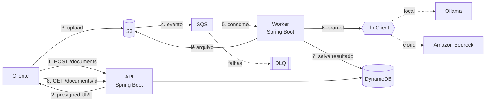

# Distill

Um backend em Java que recebe documentos, processa em segundo plano com um LLM e devolve um resumo, os pontos principais e algumas tags.


---

## Por que esse projeto existe

Eu queria um projeto que fosse pequeno o bastante para terminar, mas que me obrigasse a mexer com as coisas que aparecem em sistemas de verdade: fila, retry, idempotência, upload direto para o S3, infraestrutura como código e uma integração com LLM que não quebre quando o modelo demora ou responde errado.

A ideia do Distill é simples. Você manda um texto ou PDF, o sistema coloca na fila, um worker lê o conteúdo, pede para o modelo resumir e guarda o resultado. Depois você consulta pela API.

O outro objetivo é testar como é construir tudo isso com ajuda de IA desde a primeira linha. Falo mais disso [mais abaixo](#como-estou-construindo).

---

## Como funciona



O cliente começa pedindo à API para criar um documento. A API registra o item no DynamoDB com status `PENDING` e devolve uma URL pré-assinada do S3. O arquivo sobe direto para o bucket, sem passar pela API, o que evita que ela vire gargalo.

Quando o arquivo chega, o S3 manda um evento para a fila SQS. O worker pega a mensagem, baixa o arquivo, extrai o texto, monta o prompt e chama o LLM. A resposta vem em JSON, é validada e gravada no DynamoDB com status `DONE`. Se algo der errado, a mensagem tenta de novo algumas vezes e, se continuar falhando, vai para a DLQ para eu investigar depois.

---

## Decisões de design

Algumas escolhas que valem explicar, porque são o motivo de o projeto ter a forma que tem.

**Assíncrono por padrão.** Chamar um LLM é lento e instável. Se a API esperasse a resposta, qualquer oscilação do modelo viraria timeout para o usuário. Com a fila no meio, a API responde rápido e o worker trabalha no ritmo dele.

**Upload por URL pré-assinada.** Mandar o arquivo pela API obrigaria ela a carregar o corpo da requisição inteiro. Deixar o cliente subir direto para o S3 é mais barato e escala melhor.

**Idempotência.** O SQS garante entrega *at-least-once*, então a mesma mensagem pode chegar duas vezes. Para isso não gerar resultado duplicado, o worker usa escrita condicional no DynamoDB, baseada no `documentId` e no status atual do item.

**Retry e DLQ.** Falhas temporárias, como timeout do modelo, são tentadas de novo com backoff. Mensagens que continuam falhando vão para a dead-letter queue, para não travar o resto da fila.

**LLM atrás de uma interface.** O código só conhece o `LlmClient`. Em desenvolvimento ele fala com o Ollama na minha máquina, sem custo. Na AWS, troca para o Amazon Bedrock apenas mudando o perfil de configuração.

**Saída estruturada.** O prompt pede JSON em um formato fixo e o worker valida antes de salvar. Se o modelo devolver algo fora do formato, conta como falha e entra no fluxo de retry.

**Limites de entrada.** Existe um tamanho máximo de arquivo e o texto longo é dividido em partes, para respeitar a janela de contexto do modelo e controlar custo.

**Observabilidade.** Logs estruturados e métricas no CloudWatch: latência do LLM, taxa de erro e tamanho da fila.

---

## API

O desenho ainda pode mudar, mas por enquanto é este:

| Método | Rota | O que faz |
|---|---|---|
| `POST` | `/documents` | Cria o registro e devolve o `documentId` e a URL de upload |
| `GET` | `/documents/{id}` | Retorna status e resultado |
| `GET` | `/documents` | Lista paginada |
| `DELETE` | `/documents/{id}` | Remove o documento e o resultado |
| `GET` | `/actuator/health` | Health check |

Um resultado pronto fica assim:

```json
{
  "id": "7f3c1e2a",
  "status": "DONE",
  "result": {
    "summary": "Resumo curto do documento...",
    "keyPoints": ["ponto 1", "ponto 2", "ponto 3"],
    "tags": ["backend", "aws"],
    "language": "pt-BR"
  },
  "createdAt": "2026-11-03T12:00:00Z",
  "processedAt": "2026-11-03T12:00:08Z"
}
```

O status passa por `PENDING`, `PROCESSING`, `DONE` ou `FAILED`.

---

## Dados

Tudo fica em uma tabela só do DynamoDB, a `distill-documents`.

| Atributo | Tipo | Descrição |
|---|---|---|
| `pk` (partition key) | String | `DOC#<documentId>` |
| `status` | String | `PENDING`, `PROCESSING`, `DONE` ou `FAILED` |
| `s3Key` | String | Onde o arquivo está no bucket |
| `result` | Map | Resumo, pontos-chave e tags |
| `error` | String | Mensagem de erro, se houver |
| `attempts` | Number | Quantas vezes já tentou processar |
| `createdAt` / `processedAt` | String (ISO-8601) | Datas |

---

## Stack

- Java 21 com Spring Boot 3 (Web, Actuator, Validation)
- Maven em modo multi-módulo
- AWS SDK for Java v2
- Ollama para o LLM local e Amazon Bedrock na nuvem
- AWS CDK, escrito em Java, para a infraestrutura
- Docker Compose e LocalStack para rodar tudo localmente
- JUnit 5, Mockito e Testcontainers nos testes
- GitHub Actions para CI

---

## Estrutura do repositório

```
distill/
├── api/                 # API REST (Spring Boot)
├── worker/              # Consumidor SQS e chamada ao LLM
├── core/                # Domínio, DTOs, interface LlmClient, prompts
├── infra/               # AWS CDK (Java)
├── docs/                # ADRs, diagramas, notas de design
├── docker-compose.yml   # LocalStack e Ollama
├── AGENTS.md            # Instruções para os agentes de código
├── pom.xml
└── README.md
```

---

## Rodando localmente

Você precisa de Java 21, Maven, Docker e o Ollama com algum modelo baixado.

```bash
# sobe o LocalStack (S3, SQS, DynamoDB)
docker compose up -d

# baixa um modelo local
ollama pull qwen3:4b

# sobe a API e o worker
./mvnw -pl api spring-boot:run
./mvnw -pl worker spring-boot:run
```

Existem dois perfis de configuração. O `local` usa LocalStack e Ollama. O `aws` usa os serviços reais e o Bedrock.

---

## Deploy na AWS

```bash
cd infra
cdk bootstrap
cdk deploy
```

Isso cria o bucket S3, a fila SQS com DLQ, a tabela DynamoDB, os serviços ECS Fargate (API e worker), as roles IAM com o mínimo de permissão e alarmes no CloudWatch.

Atenção aos custos: Fargate, NAT Gateway e Bedrock cobram. Quando terminar de testar, rode `cdk destroy`.

---

## Como estou construindo

Esse projeto está sendo feito do zero com apoio de LLMs em todas as etapas, e dividi o trabalho assim:

- Os modelos locais, rodando no Ollama, ajudam com rascunhos, prompts, textos de documentação, dados de teste e ideias de design.
- O código é escrito e editado no opencode, usando DeepSeek Flash e GLM, para implementação, refatoração e testes.
- O arquivo `AGENTS.md` guarda as convenções, a estrutura dos módulos e o que os agentes não devem mexer.
- Eu reviso tudo, rodo os testes e faço os commits manualmente.

---

## Roadmap

- [x] Fase 0: README, estrutura do repositório e `AGENTS.md`
- [x] Fase 1: módulo `core` com domínio, interface `LlmClient` e implementação Ollama
- [x] Fase 2: API com `POST` e `GET /documents` rodando no LocalStack
- [x] Fase 3: worker consumindo SQS, chamando o LLM e salvando no DynamoDB
- [x] Fase 4: idempotência, retry e DLQ
- [x] Fase 5: implementação do `LlmClient` com Bedrock
- [x] Fase 6: infra com CDK e deploy no Fargate
- [x] Fase 7: observabilidade com métricas, alarmes e logs estruturados
- [x] Fase 8: CI no GitHub Actions e testes de integração
- [x] Extra: front-end simples para upload e visualização dos resultados

As decisões de arquitetura mais importantes vão ser registradas em `docs/adr/`, no formato ADR.

---

## Licença

MIT
